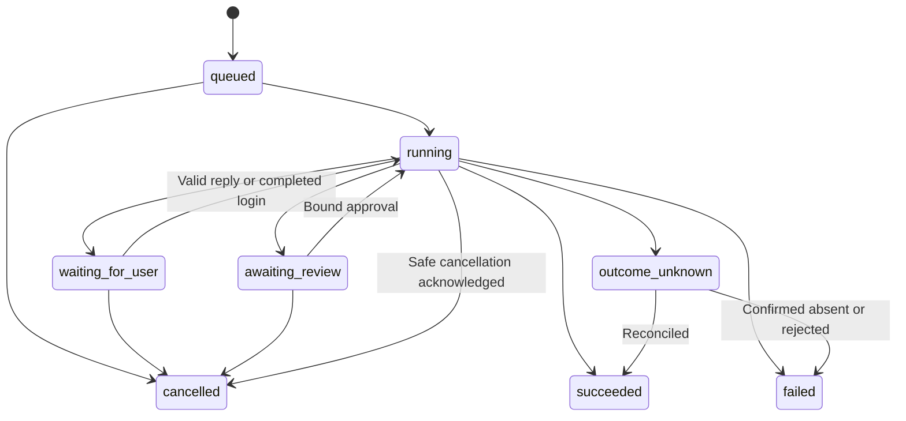

# Universal Kyrex agent platform

Status: proposed architecture and migration criteria, 2026-10-15.
Source baseline: `a359780fa582931a6edec89f6a88ee70a07afae2` on `main`.
This document does not enable new operations or change existing approvals.
See the [integration audit](integration-audit.md) for the source inventory.

## Product contract

A user connects an account or device once, chooses the relevant resources, and
can ask any eligible Kyrex assistant to use those capabilities. The assistant's
model and personality do not determine which website or service Kyrex knows.
Explicit account, Bot and host restrictions still apply.

The same request has the same authorization and task identity whether it starts
in Chat, a terminal, the IDE, VS Code, voice or a configured automation. Each
surface may show the task differently. Accepted work is owned by the execution
service and remains observable after the originating surface disconnects.

Universal means a common way to discover, authorize, run and recover work.
Vendors still need protocol adapters; browser automation still has compatibility
limits. It does not mean arbitrary websites always work, every model supports
every tool, or connecting an account grants every available write.

Examples must generalize: booking a class and reserving a table use reusable
task, account, browser and review primitives. A shopping request can research
and prepare a cart using that same platform, but purchases require a separately
implemented and authorized payment/submission capability. Kyrex does not yet
have a general purchase executor.

## Reuse the foundations

| Existing component | Responsibility to retain | Extension needed |
| --- | --- | --- |
| [Python engine](../../kyrex_engine/kyrex/core.py), [bridge](../../kyrex_engine/core_bridge.py) | Reasoning loop, tools, sessions, bounded execution | Host-mediated capability discovery and invocation across surfaces |
| [Policy](../../kyrex-cloud/policy.py), [serve](../../kyrex-cloud/serve.py) | Host-derived operation tiers, restrictions and executor gates | Consistent operation/effect metadata and execution context |
| [CloudTaskStore](../../kyrex-cloud/task_store.py), [Flux](../../kyrex-cloud/flux.py), [worker](../../kyrex-cloud/worker.py) | Durable claims, approvals, progress, results and event replay | Common lifecycle for remaining Chat and connector-specific jobs |
| [Connector store](../../kyrex-cloud/connectors.py), existing service stores | Encrypted account grants, refresh and provider checks | Shared account/resource references and safe capability projections |
| [Browser Host](../../kyrex-cloud/browser_host_bridge.py), [manual mode](../../browser-host/manual_mode.py) | Enrolled resources, dispatch and exclusive profile access | Profile resources independent of Bot persona, health and human handoff |
| [Provider resolver](../../kyrex-cloud/web/backend/bot_provider.py) | Owner profile plus exact Bot model, no silent global fallback | One provider identity with model-specific protocol negotiation |

Do not replace these with a second engine or expose unrestricted engine tools
inside Chat. Its `KYREX_READ_ONLY_REPO` boundary protects repository access;
connected-service tools should be host-mediated separately.

## Shared contracts

The names below are proposed contracts, not classes or APIs already shipped.

| Contract | Required fields and behavior |
| --- | --- |
| Capability definition | Stable ID/version; input/output schemas; operations and effects; required grant/resource types; supported execution location; preparation, validation, execution and reconciliation hooks |
| Connection | Authenticated owner; provider; account ID; encrypted credential reference; grant revision; live scopes; selected resources; revoke/refresh behavior; safe status |
| Execution context | Server-derived owner, task/conversation/Bot IDs, origin surface, selected account/resource refs, policy decision, approval refs, deadline, cancellation and audit context |
| Task | Stable ID and owner-scoped submission key; original intent; timezone; validated plan revision; parent/child relationships; state; checkpoint; attempts; event cursor; result refs |
| Effect review | Owner/task/operation; exact target and payload digest; account/resource and grant revisions; relevant price/quantity/time/recipient/terms; expiry; single-use claim |
| Effect receipt | Attempt ID; provider idempotency key where supported; operation/review revision; provider reference; verified/failed/unknown outcome; reconciliation evidence |
| Resource lease | Owner, resource/profile/device, holder task/manual session, expiry/heartbeat and fencing token; no competing writers |

A capability definition says what an adapter can do. Availability derives from
the current owner's grant, live resource health, host policy and Bot restrictions.
The model receives safe descriptions and opaque references, never credentials.
Backend discovery should drive Connections cards, routing metadata, tool schemas
and diagnostics. Capability exposure and execution must use the same decision.

Keep infrastructure configuration separate from user connections. A server's
Google OAuth client or Firestore service account supports the deployment; it is
not a user's Google grant. A user's speech key is not a fallback LLM key. A
server operator's target repository is not every tenant's default workspace.

Authorization is the intersection of authenticated ownership, enabled capability,
live provider scopes, selected resources, host limits, explicit Bot restrictions
and any required review. Routers, skills and model output cannot enlarge it.
Revalidate at the external call, including for delegated and scheduled tasks.

## One task lifecycle

This is a target state model. Map existing CloudTaskStore and feature states
through an explicit migration; do not rename stored values in place or assume
the current worker can resume every checkpoint.

- **Accept before streaming.** Persist the task and submission key before
  acknowledging it. A lost acknowledgement can be resolved by looking up the
  same key; it cannot create another effect.
- **Reconnect by task ID and cursor.** Screen sleep, SSE loss and voice device
  changes reattach to the saved task. Stop playback/listening and cancel task
  execution are separate controls.
- **Checkpoint safe work.** Persist validated preparation and review state.
  Workers use leases and fencing so a stale process cannot submit later.
  Retry only operations known to be safe to repeat.
- **Wait explicitly.** Missing details, login/MFA and a busy profile report the
  reason, resource and next step. A human can complete login on another device
  without reconstructing the request. Secrets and MFA codes stay out of prompts.
- **Observe actual work.** User-visible status includes direct work and child
  tasks. A browser job cannot disappear merely because it was not delegated.
- **Cancel honestly.** Cancellation before submission stops the effect. Once an
  external request may have been sent, record the outcome or reconciliation
  requirement rather than claiming the effect was undone.

Current workout disconnect recovery saves a pending turn and detaches a bounded
producer from HTTP. Its producer is process-local; it is not a restart-resumable
universal worker. Migrate it using the same task lifecycle as other capabilities.

## Review and external effects

Use existing tiers as the authority during migration, and add explicit effect
metadata rather than inferring risk solely from tool names. `cal:create` and
`messages:send_level6` have executor/feature gates despite base tier zero.
Likewise, a browser click can finalize an order even when it contains no typing.

Prepare a review from observed state. Resolve the actual calendar, class,
recipient, repository or product before asking for approval. Bind approval to
the current account, target, payload and terms. Relevant changes expire it.
A plain "yes" can approve only one unambiguous pending review belonging to that
owner and conversation/task context; otherwise ask which review is meant.
Voice and cross-device approvals must reference the same stored review.

Atomically claim the approved attempt before the external call. Use provider
idempotency and conditional version checks where available. An internal claim
alone cannot guarantee exactly-once execution across an external system.
If a process dies or a response is lost after submission, mark the outcome
unknown and reconcile against provider history/status. Do not blindly replay.
Reconciliation may prove success, failure, or remain unresolved; do not turn
absence of evidence into permission to retry.

Existing specialized reviews remain authoritative until their replacement passes
parity checks. The platform migration does not relax paid-booking restrictions,
enable unattended purchases, or make a past approval reusable.

## API adapters and the browser

Prefer a configured, supported API for a task when it provides the necessary
operation and reliable result verification. Browser fallback uses the owner's
enrolled browser resource when an API is unavailable or insufficient. A task
must carry its selected account and intent across that boundary; it must not
silently switch accounts, sites or delivery channels.

A general browser operator should inspect a page, choose the next constrained
action, observe the result, and continue within the same engine/tool loop.
Reusable browser primitives already exist, but a prepared action list is not
by itself this adaptive capability. New-site onboarding should not require
adding a route to `chat_service.py` for each ordinary task.

Generic browser work still needs controlled navigation, redirect and network
checks, workspace-confined files, profile leases, deadlines and effect-aware
submission interception. Never make an empty allowlist mean all sites. Offer
validated owner-managed site permissions and any required consent. Page content
and inbound messages are untrusted task data, not authority to change the plan.

Login is a resource state. Offer a secure, time-limited viewer handoff for the
selected profile, release it before automation resumes, and keep cookies on
that host. Distinguish container healthy, host online, profile available, browser
launchable, site reachable and signed in. A container health check cannot prove
all six. Clean stale Chrome locks only after proving no browser holds the
profile; preserve the profile and login data.

Profiles should become owner/account/workspace resources shared only through
explicit bindings. Existing owner-plus-Bot isolation stays until a reviewed
migration offers a deliberate reuse choice; never merge profiles automatically.

Site adapters remain useful for structured data and dependable verification.
Level 6 should become an optional configured studio workflow, using common
fitness, booking, calendar, messaging, scheduling and review capabilities.
Its studio ID, timezone, preferred slot and group recipient are workflow
configuration, not defaults for other users.

## Models, devices and deployment

Resolve provider identity once and select a supported protocol per model. One
OpenCode profile can dispatch Responses, Messages, Google or chat-completions
protocols through adapters. A model appearing in a list is not a successful
inference test. Keep tool availability separate from model selection; report an
unsupported tool/protocol clearly instead of silently choosing another model.

Voice is an input/output adapter to the same task pipeline. Shared speech
settings and per-device revocable credentials already exist. Keep OS-specific
microphone/background behavior in companions; do not add a parallel booking or
mail executor to them. Spoken reviews must preserve the exact stored action.

Local use should remain local where configured. A local terminal identity and a
cloud account must be explicitly linked before sharing cloud grants. Standalone
MCP processes and Python extensions are trusted local code today; they are not
safe multi-tenant plugins merely because their tools have schemas.

The first migration can retain the existing persistent-volume web/worker
deployment. Do not share SQLite or JSON files across unrelated VPS hosts. Before
adding replicas, use storage with the needed transaction/claim semantics,
cross-process safe registries, durable authentication handoffs, tenant quotas
and fair resource scheduling. Resource agents consume bounded authorized jobs;
they do not receive all tenant secrets or a general shell authority.

## Migration sequence and completion gates

| Phase | Deliverable | Completion gate |
| --- | --- | --- |
| 1: inventory and discovery | Backend capability/connection projection wrapping existing adapters; per-operation health; account/resource references | Every current integration is represented honestly, including unavailable and unsupported operations; UI and router use the same safe projection |
| 2: shared execution context | Typed host-mediated connected tools in the existing engine; retain legacy routes as compatibility adapters | Calendar/mail can be combined by eligible Bots without persona routing granting authority; scope revocation and explicit Bot denies still apply |
| 3: durable lifecycle and effects | Adopt CloudTaskStore/Flux for remaining connector jobs; review/receipt references, lease/recovery and reconciliation contracts | Screen-off, restart and duplicate confirmation tests do not duplicate effects; unknown outcomes remain visible |
| 4: account and resource portability | Multi-user admission, per-user settings/automations, explicit browser profile bindings and device/resource discovery | Two unrelated users can configure different services/studios/accounts without code or deployment-wide owner edits and without data leakage |
| 5: broader workflows | Adaptive browser capability and configurable domain templates; migrate Level 6 onto it; voice/scheduled parity | An unfamiliar supported site works without a new Chat route; unsupported/payment/login cases return actionable state; old workflows retain reviewed behavior |

Phases can overlap through narrow vertical changes. Do not postpone reliability
fixes until a rewrite. Preserve rollback paths and avoid dual execution during
migration: choose exactly one authoritative executor for each accepted task.

First implementation slice: expose the common discovery and execution-context
contracts for Google Calendar and selected email reads, backed by their existing
adapters. Let the engine answer a combined email-and-calendar request under one
task identity. Follow with the existing calendar write review, then browser
preparation/recovery. Keep other routes working through compatibility adapters.

## Acceptance scenarios

1. Two owners use different models and calendars; neither can discover or invoke
   the other's grants, messages, memory, profile or results, including guessed IDs.
2. An eligible general Bot reads email and calendar; an explicit Bot deny still
   wins. Naming a Bot "Calendar" or changing its model cannot grant access.
3. Changing the selected mailbox/account or revoking scopes after preparation
   invalidates the review. Ambiguous accounts and recipients require selection.
4. A task survives phone screen sleep and is visible from another device. Worker
   failure preserves a truthful terminal/waiting/unknown outcome. No client retry
   can create a second booking or message.
5. A new studio and timezone require settings plus supported adapters, not a
   global route, branch constant or recipient change. Calendar scheduling and
   website booking remain distinct effects derived from the user's intent.
6. A supported unfamiliar site can be researched and prepared through observed
   browser steps. A checkout click, changed price, login challenge or unsupported
   payment path cannot bypass the required handoff/review boundary.
7. Voice, Chat and automation use the same selected account, policy and receipt.
   A schedule cannot turn read consent or a past review into future send authority.
8. Disconnecting an account revokes future calls and invalidates dependent reviews
   across workers and devices; retention/deletion behavior is stated per store.

These are implementation acceptance criteria, not claims of passing live tests.
